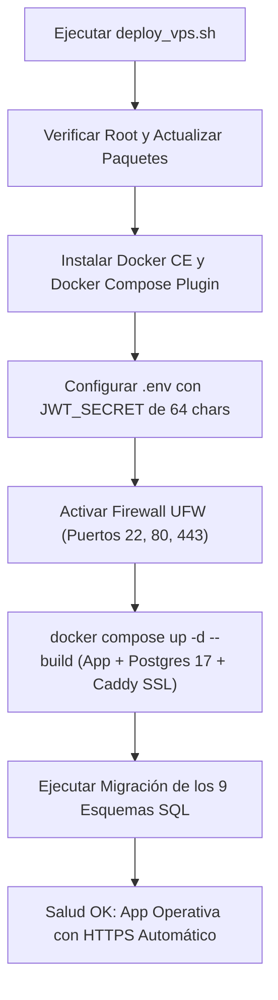

# 🚀 Memoria de Configuración de Producción & Despliegue VPS - Radar SECOP

Este documento preserva la memoria técnica consolidada de todos los parámetros de configuración, variables de entorno, secretos criptográficos y procedimientos requeridos para el momento en que se ejecute el despliegue final en el VPS Linux.

---

## 📋 1. Checklist de Parámetros y Credenciales Requeridas al Subir

Cuando se realice el despliegue en el servidor Linux, se completarán las siguientes variables en el archivo `.env`:

| Variable | Descripción / Destino | Estado Actual / Valor por Defecto |
| :--- | :--- | :--- |
| `DOMAIN` | Dominio o subdominio asignado al SaaS (ej. `radar.tudominio.com` o la IP pública). | `:80` (modo local / IP) |
| `ACME_EMAIL` | Correo electrónico del administrador para emisión y renovación automática de certificados SSL con Let's Encrypt. | `admin@tudominio.com` |
| `PORT` | Puerto interno del contenedor web Express. | `3000` |
| `NODE_ENV` | Entorno de ejecución de Node.js. | `production` |
| `PGDATABASE` | Nombre de la base de datos transaccional en PostgreSQL 17/18. | `radar_secop` |
| `PGUSER` | Usuario administrador de la base de datos. | `postgres` |
| `PGPASSWORD` | Contraseña robusta para la base de datos (se genera automáticamente si no existe). | Generada en instalador |
| `JWT_SECRET` | Llave secreta criptográfica de 64 caracteres hexadecimales para firma de tokens JWT (multi-tenant). | Generada con `openssl rand -hex 32` |
| `CRON_SCHEDULE` | Expresión cron para escaneo recurrente de SECOP II. | `0 * * * *` (cada hora) |
| `SOCRATA_APP_TOKEN` | Token de aplicación oficial de [datos.gov.co](https://www.datos.gov.co) para eliminar rate limits en consultas masivas. | Pendiente de registrar al desplegar |
| `TELEGRAM_BOT_TOKEN` | Token del bot de Telegram (`@BotFather`) para alertas móviles instantáneas. | Pendiente de registrar al desplegar |
| `TELEGRAM_CHAT_ID` | Identificador de chat o canal de Telegram donde se recibirán las notificaciones. | Pendiente de registrar al desplegar |
| `GEMINI_API_KEY` | Clave API de Google AI Studio para lectura inteligente OCR de certificados RUP y análisis de pliegos extensos (Gemini 4 Argon / 3.8 Flash). | Pendiente de registrar al desplegar |

---

## 🛠️ 2. Flujo de Despliegue en 1 Solo Comando (VPS Linux)

En cualquier VPS con **Ubuntu 22.04 LTS / 24.04 LTS** o **Debian 12**, el comando de instalación desatendida es:

```bash
git clone https://github.com/nicolasllano-NIKADU/radar-secop.git
cd radar-secop
chmod +x scripts/deploy_vps.sh
./scripts/deploy_vps.sh
```

### ¿Qué ejecuta automáticamente el instalador?


---

## 📦 3. Esquemas SQL Consolidados en PostgreSQL

La inicialización ([`server/initDb.js`](file:///c:/Users/nikyl/Downloads/Antigravity/Radar%20SECOP/server/initDb.js)) garantiza idempotencia y aplica secuencialmente:

1. `schema.sql` (Oportunidades, historial de escaneo, configuración general)
2. `schema_paa.sql` (Planes Anuales de Adquisiciones 2026 y matching comercial)
3. `schema_post_adjudicacion.sql` (Contratos adjudicados, actas de obra, pólizas y adiciones)
4. `schema_compliance.sql` (Auditoría LAFT, lista Clinton, inhabilidades y hash SHA-256)
5. `schema_economico.sql` (Simulaciones Monte Carlo, TRM y 5 métodos CCE Pliegos Tipo)
6. `schema_pipeline.sql` (Tablero Kanban multifase, tareas interdisciplinarias y Go/No-Go)
7. `schema_auth.sql` (Usuarios, roles RBAC y vinculación multi-tenant)
8. `schema_competencia.sql` (Caché agregada de contratistas, cuota de mercado e índice HHI)
9. `schema_predictivo.sql` (Contratos por vencer a 30, 60 y 90 días, certeza legal y alertas)

---

## 🔄 4. Actualizaciones Futuras en Producción (Zero-Downtime)

Para actualizar el servidor con nuevos cambios desarrollados en local y subidos a GitHub:
```bash
cd radar-secop
./scripts/deploy_vps.sh
```
*(El script detecta el directorio `.git`, ejecuta `git pull origin main`, reconstruye la imagen y aplica cualquier nueva migración de base de datos sin borrar los datos existentes).*
