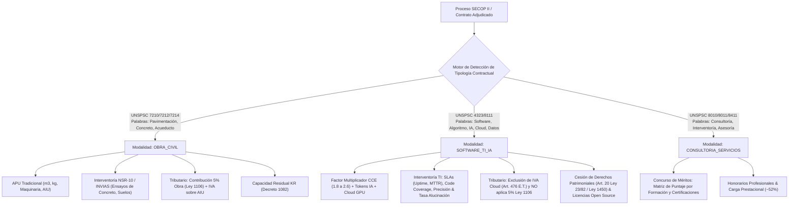
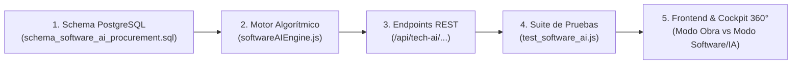

# Plan Maestro: Diferenciación Contractual y Suite Especializada de Software & Inteligencia Artificial

> [!IMPORTANT]
> **Propósito Central del Ecosistema Híbrido:**
> Radar SECOP ahora implementa un **motor de discriminación de tipología contractual** que bifurca automáticamente las reglas de negocio, costeo, supervisión técnica y tributación cuando un proceso o contrato corresponde a **Desarrollo de Software, Consultoría y Servicios de IA (`SOFTWARE_TI_IA`)** frente a contratos de **Infraestructura y Obras Civiles (`OBRA_CIVIL`)**.

---

## 1. Arquitectura de Diferenciación Automática

El sistema clasifica cada oportunidad o contrato en una de tres tipologías operativas basándose en el código UNSPSC, el objeto contractual y el perfil asignado:

---

## 2. Los 5 Componentes de la Suite de Software & IA

### Componente 1: Motor de Factor Multiplicador & Presupuestación de Sprints / Tokens de IA
* **Marco Legal:** Guía para Concurso de Méritos de Colombia Compra Eficiente (CCE) y Decreto 1082 de 2015.
* **Modelo Matemático del Factor Multiplicador ($FM$):**
  $$FM = 1 + \text{Factor Prestacional (50\% - 55\%)} + \text{Costos Indirectos y Herramientas (25\% - 35\%)} + \text{Utilidad y Honorarios (15\% - 25\%)}$$
  Típicamente resulta en un rango de **$1.8$ a $2.6$** sobre el costo directo del salario básico mensual.
* **Costeo Especializado de Proyectos de Software & IA:**
  * **Roles Especializados de TI:** AI Engineer, Prompt Engineer, Fullstack Dev, Cloud Architect, DevOps/SRE, QA Automation, Scrum Master, Data Scientist.
  * **Cómputo en la Nube y Modelos Fundacionales:**
    * Inferencia de LLMs (costeo por millón de tokens de entrada/salida para Gemini, OpenAI, Claude).
    * Almacenamiento e indexación vectorial (embeddings RAG).
    * Instancias GPU reservadas (NVIDIA H100 / A100 / L4) para fine-tuning o inferencia privada.

### Componente 2: Supervisión Técnica, SLAs & Calidad de Modelos de IA
* **En reemplazo de los ensayos de concreto NSR-10**, la interventoría de software e IA supervisa:
  * **Acuerdos de Niveles de Servicio (SLAs):**
    * Disponibilidad del Sistema (*Uptime* $\ge 99.9\%$).
    * Latencia de Respuesta de APIs ($\le 200 \text{ ms}$).
    * Tiempo Medio de Resolución de Incidentes Críticos ($MTTR \le 2 \text{ horas}$).
  * **Aseguramiento de Calidad de Software (QA):**
    * Cobertura de pruebas unitarias e integración ($\ge 80\%$).
    * Vulnerabilidades de seguridad OWASP Top 10 (cero vulnerabilidades críticas/altas).
  * **Métricas Periciales de Inteligencia Artificial:**
    * Exactitud y Calidad del Modelo (*Accuracy* / *F1-Score* $\ge 90\%$).
    * Tasa de Alucinación Tolerada ($\le 2.0\%$).
    * Tasa de éxito en ejecución de herramientas (*Tool-Calling / Agentic Accuracy* $\ge 95\%$).

### Componente 3: Evaluador de Equipo de Trabajo para Concurso de Méritos
* **Marco Legal:** Ley 1150 de 2007, Art. 2 Numeral 3. En Concurso de Méritos, **el precio no otorga puntaje**; la adjudicación depende exclusivamente de la propuesta técnica y la experiencia del personal.
* **Matriz de Ponderación:**
  * Formación de Posgrado (Especializaciones, Maestrías, Doctorados en Ciencias de la Computación, IA o ramas afines).
  * Certificaciones Internacionales Validadas (AWS Certified Solutions Architect, Google Cloud Professional, Azure AI Engineer, PMP, Scrum Master PSM/CSM).
  * Meses de Experiencia Específica acreditada en proyectos de alcance similar mediante certificaciones contractuales.

### Componente 4: Propiedad Intelectual, Entregables & Licenciamiento Open Source
* **Marco Legal:** Ley 23 de 1982, Decisión 351 de la CAN y Ley 1450 de 2011 (Art. 20).
* **Funcionalidad:**
  * Generador de **Acta Formal de Cesión de Derechos Patrimoniales de Autor** sobre el software desarrollado a favor de la Entidad Estatal, preservando los derechos morales del autor.
  * Auditoría de **Librerías de Terceros y Código Abierto**: Clasificación de licencias permisivas (MIT, Apache 2.0, BSD) vs licencias recíprocas/copyleft (GPL v3, AGPL) para blindar a la entidad contra reclamos de contaminación de código.
  * Lista de chequeo de entregables técnicos: Repositorio Git con historial completo, Dockerfiles, manifiestos de Kubernetes/IaC, diagramas C4 y manuales de arquitectura.

### Componente 5: Régimen Tributario Especial de TI
* **Estatuto Tributario Nacional:**
  * **Exclusión de IVA (Art. 476 Numeral 23 y 24 E.T.):** Servicios de computación en la nube (*Cloud Computing*) y desarrollo de sitios web / páginas comerciales están **excluidos de IVA**.
  * **Blindaje contra la Ley 1106 de 2006:** Desactivación estricta y automática de la retención del 5% de obra pública (evitando cobros indebidos por parte de entidades territoriales desinformadas).
  * Tarifas de Retención en la Fuente ajustadas: Servicios calificados (11% o 3.5%) y compras de software/licenciamiento (2.5% o 3.5%).

---

## 3. Plan de Implementación Paso a Paso

1. **Base de Datos Relacional (`server/schema_software_ai_procurement.sql`):**
   * `tech_ai_proyectos_estimacion`: Factor multiplicador, roles, salarios, sprints y cómputo GPU/tokens.
   * `tech_ai_metricas_sla_calidad`: Uptime, latencia, MTTR, code coverage, F1-score y tasa de alucinación.
   * `tech_ai_propiedad_intelectual`: Registro de entregables, repositorios, licencias y actas de cesión.
   * `tech_ai_equipo_concurso_meritos`: Perfiles, títulos, certificaciones y cálculo de puntaje CCE.
2. **Motor Algorítmico (`server/softwareAIEngine.js`):**
   * `calcularFactorMultiplicador(...)`
   * `estimarCostoTokensYCloud(...)`
   * `evaluarSlasYCalidadIA(...)`
   * `generarPropuestaTecnicaConcursoPdf(...)`
   * `generarMemoriaCosteoSoftwareExcel(...)`
3. **Endpoints REST en `server/app.js`**:
   * Rutas para simulación de costos TI, evaluación de SLAs de software, verificación de licencias y generación de reportes en PDF y Excel.
4. **Selector Visual Dinámico en Frontend (`public/index.html` y `public/app.js`):**
   * Conmutador en el Cockpit 360° y en los modales: `[🏗️ Vista Obra Civil]` vs `[🤖 Vista Software & IA]`.
   * En modo Software & IA, los campos se adaptan dinámicamente de "concreto y maquinaria" a "sprints, roles de desarrollo, tokens y SLAs".
