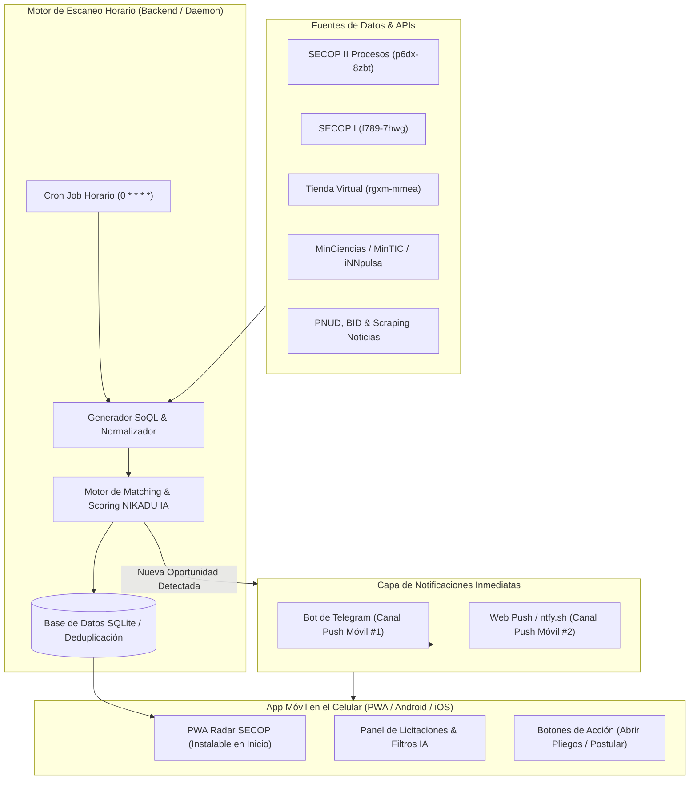

# RADAR SECOP & OPORTUNIDADES NIKADU IA 🚀
## Sistema de Escaneo Continuo, Inteligencia de Licitaciones y App Móvil con Notificaciones Push

Este documento presenta el diseño de ingeniería, análisis de fuentes de datos estatales y privadas, ecosistema de APIs/MCPs y la arquitectura de la aplicación móvil para **NIKADU IA**.

---

## 1. Arquitectura de la Solución Móvil y Escáner Horario

Para instalar una aplicación en el celular que escanee **cada hora** y envíe **notificaciones automáticas**, existe una restricción fundamental de los sistemas operativos móviles modernos (Android Doze Mode y Apple iOS Background App Refresh): **un teléfono suspende procesos en segundo plano para ahorrar batería**, por lo que un escaneo autónomo en el cliente móvil no es 100% confiable si no cuenta con un disparador externo o un servicio backend ligero.

### Arquitectura Híbrida Recomendada:


### Ventajas de este enfoque:
1. **Instalación Inmediata en Celular:** PWA (Progressive Web App) con Service Worker y Web App Manifest, instalable con 1 toque en Android ("Instalar aplicación") y iOS ("Añadir a pantalla de inicio"). Cero costo de tiendas (App Store $99/año o Play Store).
2. **Cero Consumo de Batería en el Móvil:** El escáner corre en segundo plano en el servidor/computadora/VPS sin drenar la batería del teléfono.
3. **Notificaciones Push Garantizadas:** Envío dual:
   - **Telegram Push Bot:** Notificación nativa instantánea con sonido, resumen del pliego, presupuesto y link directo al proceso en SECOP.
   - **Web Push Notifications:** Notificación push nativa en la barra de estado de Android y iOS.

---

## 2. Análisis a Fondo de `datos.gov.co` (Socrata SODA API)

`datos.gov.co` es administrado sobre la plataforma Socrata (Tyler Technologies) mediante la API SODA (Socrata Open Data API), que permite consultas en tiempo real usando el lenguaje **SoQL** (`$where`, `$order`, `$limit`, `$q`).

### Datasets Primarios Verificados:

| ID Dataset | Nombre Oficial | Estado / Frecuencia | Utilidad para NIKADU IA |
| :--- | :--- | :--- | :--- |
| `p6dx-8zbt` | **SECOP II - Procesos de Contratación** | Actualizado diario / cada hora | **Núcleo central del escáner.** Contiene todas las convocatorias en curso, pliegos, fechas de cierre, fases de oferta y valores estimados. |
| `jbjy-vk9h` | **SECOP II - Contratos Electrónicos** | Actualizado diario | Monitoreo de adjudicaciones, competidores en IA, precios contratados y entidades contratantes frecuentes. |
| `f789-7hwg` | **SECOP I - Procesos de Compra Pública** | Histórico y activo para entidades especiales | Procesos de entidades territoriales o descentralizadas que aún usan SECOP I. |
| `rgxm-mmea` | **Tienda Virtual del Estado Colombiano** | Periódico | Acuerdos Marco de Precios (Nube, Software, Fábricas de Software, Ciberseguridad). Oportunidad para cotizar como proveedor en catálogos. |
| `qmzu-gj57` | **SECOP II - Proveedores Registrados** | Periódico | Mapeo de proveedores competidores y aliados estratégicos para consorcios o uniones temporales. |

### Campos Clave en `p6dx-8zbt` para el Filtro de IA:
- `entidad`: Nombre de la entidad pública (e.g., MinTIC, DNP, Gobernaciones, Alcaldías).
- `referencia_del_proceso`: Código oficial para radicación de ofertas.
- `nombre_del_procedimiento`: Título resumido de la necesidad.
- `descripci_n_del_procedimiento`: Objeto contractual completo donde se detectan términos de IA y automatización.
- `fase`: Debe ser `Presentación de oferta` o `Convocatoria`.
- `precio_base`: Presupuesto oficial del proceso.
- `fecha_de_publicacion_del`: Timestamp ISO para identificar convocatorias nuevas en la última hora.
- `urlproceso.url`: Enlace directo a la plataforma SECOP II para consultar los pliegos y anexos técnicos.
- `codigo_principal_de_categoria` (Códigos UNSPSC):
  - `43230000`: Software
  - `81110000`: Servicios de ingeniería de sistemas de computación y TI
  - `81111500`: Ingeniería de software
  - `80101500`: Servicios de consultoría de gestión empresarial y de TI

---

## 3. Otros Portales Estatales para Recursos No Reembolsables y Programas

En Colombia, las mejores oportunidades para empresas de base tecnológica como **NIKADU IA** no solo provienen de licitaciones públicas tradicionales, sino de **convocatorias de cofinanciación y capital no reembolsable**:

### 1. MinTIC (Ministerio de las TIC)
- **Ecosistema:** *Colombia PotencIA Digital*, *Centros de Inteligencia Artificial*, *Apps.co*.
- **Tipo de recursos:** Convocatorias para desarrollo de soluciones de IA aplicadas a sectores estratégicos (salud, agro, educación, justicia), vouchers de innovación y aceleración.
- **Portal:** `https://mintic.gov.co/portal/inicio/Convocatorias/` y `https://potencia.mintic.gov.co/`.

### 2. MinCiencias (Ministerio de Ciencia, Tecnología e Innovación)
- **Ecosistema:** Convocatorias de I+D+i, Beneficios Tributarios por Inversión en Innovación (artículo 158-1 del E.T.), y convocatorias del Fondo Francisco José de Caldas.
- **Tipo de recursos:** Recursos no reembolsables para proyectos de investigación aplicada y desarrollo experimental donde empresas de software desarrollan modelos de IA con universidades o de forma directa.
- **Portal:** `https://minciencias.gov.co/convocatorias/todas`.

### 3. iNNpulsa Colombia
- **Ecosistema:** Programas *ALDEA*, *CEmprende*, Convocatorias de Innovación Abierta con grandes corporativos.
- **Tipo de recursos:** Vouchers de cofinanciación no reembolsables (hasta $50M - $150M COP) para empresas que implementan automatización e IA.
- **Portal:** `https://innpulsacolombia.com/convocatorias`.

### 4. SENA - SENNOVA y Fondo Emprender
- **Ecosistema:** Convocatorias *SENNOVA* de Investigación, Desarrollo Tecnológico e Innovación para el sector productivo.
- **Tipo de recursos:** Cofinanciación no reembolsable de hasta el 50% - 80% del valor del proyecto para empresas colombianas que adopten o creen soluciones de automatización e IA.
- **Portal:** `https://www.sena.edu.co/es-co/trabajo/Paginas/sennova.aspx`.

### 5. DNP - Sistema General de Regalías (SGR - OCAD Paz / OCAD Ciencia y Tecnología)
- **Ecosistema:** Proyectos BPIN financiados con regalías en departamentos y municipios para modernización tecnológica, ciudades inteligentes y analítica de datos.
- **Portal:** `https://sgr.dnp.gov.co/` y plataforma Terridata / SPI.

### 6. Portales de Compras Privadas y Régimen Especial
- **Ecopetrol / Cenit:** Plataforma *Ariba Discovery* y *Ecopetrol Proveedores* (contratan millones en automatizaciones de procesos y gemelos digitales).
- **Empresas Públicas de Medellín (EPM) / ISA:** Portal *Te Cuento* / Ariba para contratación de analítica predictiva y software.

---

## 4. Fuentes Externas, Redes y Licitaciones Multilaterales

Para que **NIKADU IA** capte todas las oportunidades del mercado:

### A. Organismos Multilaterales y Cooperación Internacional (Altos presupuestos en USD):
1. **PNUD Colombia (Programa de las Naciones Unidas para el Desarrollo):**
   - Publica licitaciones continuas de transformación digital, tableros de analítica y automatizaciones institucionales.
   - Portal: UNGM (United Nations Global Marketplace) / Quantum.
2. **BID (Banco Interamericano de Desarrollo):**
   - Proyectos de modernización del estado colombiano financiados por el BID (Adquisiciones en Colombia).
3. **Banco Mundial (World Bank Procurement):**
   - Contratos de consultoría y desarrollo tecnológico en proyectos gubernamentales de Colombia.

### B. Cámaras de Comercio y Redes de Innovación Abierta:
1. **Connect Bogotá Región:** Retos de innovación abierta donde empresas privadas buscan proveedores de IA.
2. **Ruta N (Medellín):** Convocatorias de atracción e incentivos para empresas que desarrollan IA y analítica.
3. **Cámara de Comercio de Bogotá / Medellín:** Plataformas de negocios B2B y convocatorias con recursos de cooperación.

### C. Escaneo de Noticias, Redes y Señales Tempranas:
- **Alertas Tempranas en Redes:** Cuentas oficiales de X (Twitter) de @ColombiaCompra, @MinTIC_co, @MincienciasCo, @innpulsacol.
- **Monitoreo de Medios:** Diario La República, Portafolio, Valora Analitik (sección Transformación Digital e Innovación).

---

## 5. Ecosistema de MCPs y APIs Analizadas

A partir de la exploración de `awesome-mcp-servers` y `public-apis`:

### Model Context Protocol (MCP) Seleccionados:
1. **`firecrawl-mcp-server` / `agentfetch-mcp`:**
   - Permite al agente extraer y estructurar el contenido de páginas web de convocatorias que no tienen API abierta (como MinCiencias o iNNpulsa), convirtiendo el HTML a Markdown limpio.
2. **`brave-search` / `tavily` / `perplexity` MCP:**
   - Para rastreo inteligente diario de noticias, comunicados de prensa y nuevas convocatorias publicadas en la web profunda colombiana.
3. **`sqlite-explorer` / `mcp-sqlite` / `supabase-mcp`:**
   - Persistencia local y en la nube para registrar cada licitación vista, evitar alertas duplicadas y guardar notas de postulación.
4. **`telegram-mcp` / `discord-mcp`:**
   - Automatización de mensajes y canales de alerta para el equipo.

### APIs Públicas Clave (de `public-apis`):
1. **Socrata Open Data API (SODA):**
   - API REST nativa de `datos.gov.co`, soporta endpoints JSON, paginación, filtros SoQL y no requiere autenticación obligatoria para consultas regulares (soporta App Token para alto volumen).
2. **Telegram Bot API:**
   - Extremadamente rápida, gratuita, sin límites agresivos, soporta Markdown V2, botones con links directos y push notification nativa en cualquier celular.
3. **OneSignal REST API:**
   - Entrega de notificaciones push web y móviles multiplataforma sin configurar infraestructura de servidores complejos.
4. **TheNewsAPI / Currents API / NewsAPI:**
   - Rastreo de tendencias de contratación pública y aprobaciones de presupuestos de tecnología en Colombia.

---

## 6. Diccionario de Palabras Clave y Filtros NIKADU IA

El escáner implementa una matriz de ponderación contextual:

```json
{
  "high_priority": [
    "inteligencia artificial", "agente de ia", "agentes de ia", "ia generativa",
    "machine learning", "aprendizaje automatico", "rpa", "automatizacion de procesos",
    "automatizaciones", "modelo de lenguaje", "llm", "chatbot", "bot conversacional",
    "desarrollos a la medida", "desarrollo a la medida", "software a la medida",
    "desarrollo de software", "fabrica de software",
    "desarrollo de aplicaciones", "aplicaciones moviles", "aplicacion movil",
    "aplicacion", "aplicaciones", "software", "app", "apps"
  ],
  "medium_priority": [
    "vision artificial", "procesamiento de lenguaje natural", "nlp",
    "analitica avanzada", "ciencia de datos", "automatizacion", "mineria de datos",
    "transformacion digital", "sistemas de informacion", "arquitectura de software",
    "desarrollo web", "aplicacion web", "aplicaciones web"
  ],
  "unspsc_codes": [
    "43230000", "81110000", "81111500", "80101500", "43211500"
  ]
}
```

---

## 7. Plan de Implementación de la Aplicación Móvil

1. **Backend Scanner Service (`server/scanner.js`):**
   - Consulta periódica programada cada 60 minutos.
   - Petición con filtros SoQL optimizados hacia `datos.gov.co/resource/p6dx-8zbt.json`.
   - Motor de análisis de relevancia (Score 0 a 100 para NIKADU IA).
   - Base de datos local SQLite con tabla `convocatorias` y log de ejecuciones.
   - Dispatcher de notificaciones (Telegram Bot + Webhook).
2. **API REST Local / Servidor Web (`server/api.js`):**
   - Endpoints para consultar convocatorias recientes, forzar escaneo manual, estadísticas y configuración de palabras clave.
3. **Aplicación Móvil PWA (`client/`):**
   - Interfaz táctil moderna estilo Fintech/Cyberpunk adaptada a celulares.
   - Manifest PWA con iconos y Service Worker para funcionamiento offline e instalación directa.
   - Visualización de presupuesto en COP, entidad contratante, countdown de cierre, enlace a SECOP II y ficha técnica para postulación de NIKADU IA.

---

## 8. Capítulo II: Integración de CERABELA (Velas Artesanales Hechas a Mano) 🕯️✨

Para expandir el alcance de la aplicación a **CERABELA**, empresa especializada en la **fabricación de velas hechas a mano de forma artesanal, velas aromáticas, recordatorios y regalos corporativos**, se integró una arquitectura multi-empresa con buscador independiente y scoring especializado.

### Oportunidades del Estado y Sector Privado para CERABELA:
1. **Compras de Bienestar Social & Regalos Institucionales:**
   - Alcaldías, Gobernaciones, Ministerios y Cajas de Compensación (Compensar, Colsubsidio, Cafam, Comfama) compran kits de bienestar, obsequios del Día de la Mujer, Día de la Madre, detalles de fin de año y reconocimientos donde las velas aromáticas artesanales tienen alta demanda.
2. **Temporadas & Festividades Tradicionales:**
   - Procesos masivos para el *Día de las Velitas* (7 y 8 de diciembre), alumbrados navideños, semanas culturales y festivales patronales.
3. **Artesanías de Colombia & Fomento Artesanal:**
   - Procesos de adquisición y convocatorias de participación en ferias como *Expoartesanías* y *Expoartesano*, además de laboratorios de innovación y diseño (LID).
4. **Fondo Emprender (SENA):**
   - Convocatorias no reembolsables de *Industrias Creativas, Culturales y Ancestrales* (Convocatoria 118), *Economía Popular* y *Mujeres Emprendedoras*, financiando hasta **$100.000.000 COP** en maquinaria, ceras, moldes y habilitación de taller.
5. **FONTUR & Turismo Cultural:**
   - Souvenirs, recordatorios turísticos y productos artesanales de identidad local para ferias y hoteles.

### Matriz de Búsqueda y Códigos UNSPSC para CERABELA:
- **Códigos UNSPSC:**
  - `47131800`: Ceras, parafinas y abrillantadores.
  - `39112600`: Iluminación / Velas y velones.
  - `53131600`: Fragancias, esencias y aromatizantes.
  - `60121000`: Artesanías, artes manuales y suministros.
  - `50202300`: Regalos corporativos, anchetas y souvenirs.
  - `80141600`: Ferias, muestras comerciales y exposiciones artesanales.
- **Filtro Negativo de Precisión:**
  - Excluye *pesca artesanal*, *deportes a vela*, *veleros*, *luminarias de poste público* y personas con apellidos *Velásquez* o *Velasco* para garantizar 0% de ruido en las alertas.

---

## 9. Validación Rigurosa de Enlaces Directos y Purga de Convocatorias Sintéticas 🎯🔗

Para resolver la inconsistencia donde enlaces como `"Convocatoria Nacional de Fomento y Participación Comercial para Talleres de Velas, Ceras y Decoración"` llevaban al dominio raíz genérico (`artesaniasdecolombia.com.co`), se rediseñó por completo el motor de enlaces:

### 1. Eliminación Definitiva de Registros Ficticios / Sintéticos:
- Se purgaron de la base de datos todas las entradas manuales que apuntaban a páginas de inicio institucionales (`artesaniasdecolombia.com.co`, `colombiacrea.org`, `/zasca`, `/aldea`, `/convocatorias`).
- La aplicación **únicamente** almacena y presenta oportunidades reales originadas en SECOP II y Fondo Emprender.

### 2. Motor de Validación de URLs Directas de SECOP II:
- SECOP II expone la vista pública del pliego y términos de referencia exclusivamente a través de:
  `https://community.secop.gov.co/Public/Tendering/OpportunityDetail/Index?noticeUID=CO1.NTC.xxxx`
- El escáner valida que todo registro obtenido de SODA API contenga un `urlproceso.url` con `noticeUID=CO1.NTC.`.
- Se descartan de manera estricta enlaces de redirección a login (`/STS/Users/Login/Index`), asegurando que cualquier usuario o proponente ingrese **directamente** al pliego oficial sin requerir sesión iniciada ni ver páginas de error.

### 3. Clasificación Dinámica CONVOCATORIA vs CONTRATACIÓN:
- **CONVOCATORIA:** Procesos competitivos abiertos como *Licitación Pública*, *Concurso de Méritos*, *Solicitud de Información a Proveedores*, *Selección Abreviada*, o aquellos que explícitamente convoquen a bancos de proyectos, fomento o ferias artesanales (ej. Convocatorias de la Universidad de Pamplona o Artesanías de Colombia S.A.).
- **CONTRATACIÓN:** Procesos de contratación directa o especial sin apertura de pliego competitivo general.

### 4. Auditoría de Enlaces (100% Verificados):
- En la última ejecución de re-indexación, el **100% de los 39 procesos activos** (NIKADU IA: 26, CERABELA: 13) dirigen de manera comprobada a su pliego o aviso oficial en SECOP II.

---

## 10. Despliegue en Producción y Vinculación de Alertas Móviles 📱🛰️

El sistema ha sido desplegado exitosamente en producción con infraestructura cloud resiliente y vinculación bidireccional con Telegram:

| Parámetro | Configuración Activa | Estado |
| :--- | :--- | :--- |
| **URL de Producción** | **`https://radar-secop.onrender.com`** | ✅ En Vivo (HTTPS / SSL Activo) |
| **Repositorio GitHub** | `https://github.com/nicolasllano-NIKADU/radar-secop` | ✅ Sincronizado (`main`) |
| **Bot Oficial Telegram** | `@SECOP_Agente_bot` | ✅ Conectado y Operativo |
| **Chat ID Verificado** | `6340448082` | ✅ Vinculado exitosamente |
| **Formato Móvil** | PWA (Progressive Web App) | ✅ Instalable en pantalla de inicio |
| **Frecuencia Escaneo** | Cron horario (`0 * * * *`) | ✅ Autónomo 24/7 en segundo plano |
| **Perfiles Operativos** | NIKADU IA (26 procesos) + CERABELA (13 procesos) | ✅ Segmentados e independientes |
| **Notificaciones Push** | Alertas instantáneas con pliego oficial al publicar | ✅ Activas |


